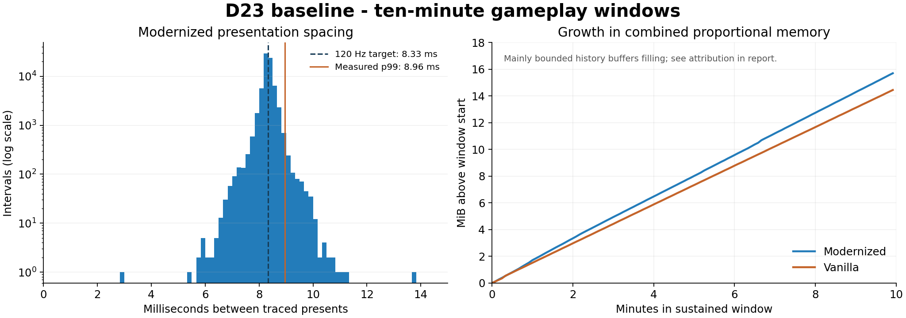

# D23 - Performance baseline and bounded stability audit

Status: Done (user-accepted), 2026-10-26. Measurements use the accepted D08Q9 player
executable; no gameplay or framework optimization is part of this audit.

The measured baseline supports the player's report of smooth, solid play.
The selected timing, loading and shutdown budgets passed. Memory growth
triggered investigation and was traced predominantly to bounded diagnostic
histories; the real audio-backend follow-ups were clean. No optimization or
player-build change was justified by these reference routes. D23C remains a
separate targeted investigation.

[Machine-readable evidence summary](reports/d23-performance-baseline.json)
contains the metrics and private raw-file hashes. The tested executable is
`9a81112c57148d928c00f8cfbd7aed33a88365640cc766395d45d1305c6beb04`.

## Purpose

The player reports that the game currently feels smooth and solid. Establish a
repeatable baseline, test sustained operation and repeated loading, and give
D23C a comparison method for the reported medieval moat/Necro slowdown.
This is a measured audit of selected routes on one machine, not certification
of every campaign location or every PC.

## Budgets chosen before the measured runs

- Emulated video fields: 59.94/s nominal; at least 59/s across a warmed scene.
  Game image updates and host presents are separate measurements. Neither a
  20/30 Hz guest animation nor a 120 Hz redraw proves simulation slowdown.
- Modernized presentation: 120/s target, at least 118/s across a warmed scene;
  p95 present spacing at most 12.5 ms and p99 at most 16.7 ms. Record outliers
  and adaptive pacing reductions rather than hiding them in an average.
- Vanilla: original 59.94 Hz field timing, native image cadence. Do not require
  new game images at 60/s or enable Modernized interpolation to meet a budget.
- Audio: zero additional output underruns in warmed measurement windows.
  Startup/loading counters are recorded separately. Dummy-device counters are
  a scheduling check, not audible crackle or real-device certification.
- Level travel: complete within 15 seconds from accepted console request to
  active gameplay; report initial startup separately because scripted input
  and skipped movies affect it. Natural level-exit progression is separate.
- Shutdown: graceful exit within 5 seconds, no forced kill.
- Memory: after warm-up, compare proportional set size (PSS), including replay
  workers, at equivalent scenes/cycles. Flag more than 64 MiB retained growth
  between matched cycles or a sustained slope above 1 MiB/min for follow-up.
  These are investigation thresholds, not proof that smaller leaks cannot exist.
- Stability: two four-level travel circuits plus a continuous ten-minute
  gameplay window in each profile, without crash, hang or lost gameplay state.
  This bounded run does not replace a multi-hour campaign soak.

## Conditions and reproducibility

Linux Mint 22.2, kernel 6.8.0-147-generic; Intel Core i7-5960X (8 cores,
16 threads), 32 GiB RAM, NVIDIA GTX 1080 Ti, NVIDIA driver 580.178.04.
OpenGL through SDL offscreen/EGL uses the real GPU. SDL dummy audio is silent.
There is no physical-display/compositor timing or listening assessment.

Modernized: 120 FPS, fast CPU timing, 150% emulated CPU, first person, 16:9,
4x internal resolution, corrected geometry/texture precision and extended draw
distance. Vanilla: original timing/presentation, 1x resolution.
Each uses a private copy of the current profile with explicit test overrides,
a 1280-pixel window setting, and fresh empty private cards. No player saves or
cards are used as test inputs; read-only file hashes check their preservation.
Private-process god mode prevents death from invalidating the
endurance route. Enemies remain enabled. Movement is scripted; the profiles
are not identical-workload benchmarks against each other.

Both profiles start from a fresh boot, then use the existing console `level N`
path for circuits through indices 0, 6, 9 and 21. Names and arrival state are
recorded from the runtime. The medieval opening is a reference scene, not a
claim to reproduce D23C's specific moat encounter. A short warm-up precedes
measurements. No builds or other game instances overlap the runs. During the
audit the player reported watching YouTube; background playback is part of the observed
desktop conditions, not assumed absent. Its exact start/stop times were not
recorded. Any outlier must be correlated with contemporary host samples rather
than attributed to either playback or the game without evidence.

Private raw evidence and harness: `recomp/analysis/d23-20261026/` (ignored).
Per-run JSON includes counters, cadence windows, phase sampling, gameplay
state, Linux pressure counters, memory and process samples, launch command,
settings and executable SHA-256. Host pressure is sampled during each run;
a later idle machine is not substituted for contemporaneous evidence.

## Results

| Profile / route | Emulated fields/s | Presents/s | Game images/s | Present p99 |
| --- | ---: | ---: | ---: | ---: |
| Modernized / 0: Time to Kill, two visits | 59.93-59.95 | 119.94-120.06 | 29.94-29.97 | 8.92 ms |
| Modernized / 6: Family Jewels, two visits | 59.91-59.97 | 119.93-120.13 | 19.97-19.97 | 8.80 ms |
| Modernized / 9: Pig Factory, two visits | 59.90-59.94 | 119.93-119.94 | 25.16-26.06 | 8.83 ms |
| Modernized / 21: Challenge Stage 1, two visits | 59.90-60.00 | 119.95-120.09 | 20.93-24.20 | 9.36 ms |
| Modernized / ten-minute window | 59.941 | 120.000 | 29.748 | 8.960 ms |
| Vanilla / ten-minute window | 59.941 | Native path, see below | Not exposed by replay counters | Not exposed by replay trace |


Modernized's ten-minute window measured 59.941 emulated fields/s, 120.000
presents/s and 29.748 original game images/s. Across 72,008 traced presentation
intervals, p50 was 8.332 ms, p95 8.667 ms, p99 8.960 ms and maximum 13.801 ms.
All sampled states stayed in active, unpaused gameplay. There were no adaptive
presentation reductions or output underruns. Graceful shutdown took 0.073 s.
The four-level circuit measurements also met the selected timing budgets.

Each profile completed nine console-driven loads: two four-level circuits,
then a return to level 0 for the sustained window. Modernized loads took
6.06-8.08 s; Vanilla 5.98-7.98 s. Both stayed below the 15 s budget, with
no forced shutdowns. Vanilla exited in 0.066 s. Whole processes ran roughly
15 minutes each. The scripted boot-to-gameplay times were 28.56 s and 31.49 s;
these include automated button timing/movies and are not normal player
startup benchmarks.

Vanilla's replay-only present counters are unavailable, not zero FPS. A
separate 60.008 s native GL present-ring sample within its sustained window
recorded 1,199 presents (19.981/s), 50 ms median, 67 ms p95/p99 and 68 ms max
at 1 ms timestamp resolution, with no GL errors. Normal 59.94 Hz emulation
continued. This preserves the original scene cadence rather than imposing
Modernized's redraw target on Vanilla.

Both sustained windows had active, unpaused gameplay in every sample. No
runtime error, adaptive Modernized rate reduction, crash or hang was observed.
Host sampling found no backup/package-manager activity; peak CPU pressure
`some avg10` was 0.41%, with I/O and memory pressure at 0.00% in the sustained
samples. The accessible kernel journal had no entries for the audit interval.
This is evidence under the recorded desktop conditions, including reported
YouTube playback, not proof that all background workloads are harmless.

### Audio interpretation

The dummy-audio sustained runs had zero output underruns, but accumulated
40,437 (Modernized) and 45,000 (Vanilla) overflow-dropped source frames. These
were retained as an exception and checked against another backend.

Separate PulseAudio-on-PipeWire checks measured 180.08 s Modernized and 60.05 s
Vanilla: **zero new underruns and zero new overflow drops** in both. Buffer
fill stayed at 144.2-193.6 ms and 158.5-182.8 ms respectively, around a 180 ms
target. The continuously accumulating dummy-path overflow did not reproduce
on that backend; these results do not establish its precise cause.

Routing limitation: SDL initially selected the normal device despite
`PULSE_SINK`; the test streams were then explicitly moved to a temporary
private null sink. The final 30-second post-routing windows also had zero
underrun/overflow increments. Routing transitions are not used as steady-state
performance evidence. The sink was removed and the default device was
verified unchanged. No listening assessment was performed. The published
repeat helper deliberately uses dummy audio only; its output is not an
unqualified real-device audio pass.

Startup/movie/loading totals are separate: pre-window overflow counts were
nonzero and are not certified clean by the warmed-window measurements.
FMV presentation/listening safeguards remain D18's scope.



### Memory threshold investigation

The Modernized sustained window rose from 709.36 to 725.06 MiB combined PSS,
with a post-first-minute slope of 1.565 MiB/min. This exceeded the initial
1 MiB/min investigation threshold and was investigated rather than ignored.

A steady Vanilla follow-up compared resident writable pages via Linux
`/proc/PID/pagemap` and attributed newly present pages to symbols in the exact
accepted executable (`nm -S`). Over 60.326 seconds, all 1,504 KiB of new
resident pages belonged to three statically allocated history rings:

| Buffer | Fixed capacity | Newly resident in the interval |
| --- | ---: | ---: |
| SIO transaction history (`sio_trace_buf`) | 28 MiB | 596 KiB |
| SIO interrupt history (`sio_irq_buf`) | 40 MiB | 568 KiB |
| Audio event history (`audio_trace.c` `s_events`) | 16 MiB | 340 KiB |

These are demand-faulted pages of existing fixed-size arrays, not fresh
unbounded allocations. SIO writers wrap at `SIO_TRACE_CAP` and
`SIO_IRQ_RING_CAP`; audio events use the `EV_RING_MASK`. Their combined ceiling
is 84 MiB, including pages already resident. `PSX_FORENSICS=0` does not disable
these particular histories. The measured Vanilla interval had no newly
resident writable pages outside those three arrays. This explains that
interval's slope.

The Modernized confirmation (a fresh Pulse-backend process) attributed
3,152 of 3,312 KiB of newly resident writable pages over 60.151 seconds to
fixed arrays: the same SIO/audio rings, the 8 MiB `s_sio_pc_trace` ring and
the 3 MiB `g_dirty_ram_flow_log`. The remaining 160 KiB was in other writable
mappings, below the 1 MiB/min investigation threshold. Its earlier process
age explains why additional histories were still filling. The longer-run
slope is consistent with the slower-filling histories remaining active.

Vanilla's ten-minute PSS grew from 400.89 to 415.34 MiB (1.450 MiB/min after
the first minute). At the same completed-circuit boundary, the second circuit
retained 24.11 MiB more than the first in Modernized and 19.99 MiB in Vanilla,
both below 64 MiB. PSS includes all replay workers where present; summing RSS
would double-count their shared pages. No unbounded leak was demonstrated;
this is bounded page-residency evidence, not an exhaustive allocation audit.

The initial raw-growth threshold remains useful: a future run must not simply
exempt all memory growth. Separate known bounded history filling from heap,
driver, worker or other allocations before accepting it. The ten-minute
footprint is not the maximum possible footprint of a multi-hour session.

## Acceptance scope

Accepted by the user as a bounded performance baseline; see closeout below. No gameplay, runtime
or dependency-pin edits or rebuild were made. The audit was presented without
commit or push; subsequent closeout is explicitly authorized below. All 91 recorded
player settings/save/card files retained their hashes, sizes and modification
times; the accepted executable hash is unchanged. Diagnostic processes ended
and the temporary audio sink was removed. Windows, other
hardware, physical-display/compositor timing, natural campaign progression,
FMV/audio listening, multi-hour sessions and every camera/refresh combination
remain outside this audit. In particular, 180/240/Unlimited and AUTO display
selection were not re-certified by the fixed-120 test.

The memory exception has an observed bounded explanation, rather than a
silent relaxation of the initial threshold. The dummy-audio anomaly is an
explicit measurement-path limitation, with a clean real-backend cross-check.
There is no new confirmed gameplay-performance regression to fix here.

## D23C handoff

Use the same executable/settings identity, host-pressure sampling, field-rate,
presentation, audio and memory counters. Reproduce the actual reported moat
position and record camera direction, enemy population and active effects.
Compare matched active-enemy and reduced-workload windows before selecting an
optimization. Console level 6 reports FAMILY JEWELS; its opening is only the
reference scene used here. It is not yet the saved moat/Necro reproduction.

Use `phase_profile` for broad wall-time attribution and differences between
`phase_hot` snapshots for native guest-function samples. Static/native phase
shares are not a function-level CPU profile and cannot by themselves identify
a bottleneck. If needed, take a separate `PSX_PROF`/caller-sampling pass; do
not mix expensive tracing or screenshot capture into the timing baseline.

Preserve emulated CPU speed, draw distance, resolution, precision settings,
view and refresh target between comparisons. Check host contention at the
time of a hitch. A later idle host, a lower game-image rate alone, or enemies
merely being present is insufficient to assign causation. Recheck any proposed
shared fix against both this baseline and the original Vanilla behavior.

## Repeating the audit

The authored Linux helper `recomp/tools/local/performance_audit.py` runs the route
against the existing player executable. It refuses an existing output folder
or an output outside `recomp/analysis`, and refuses to overlap another game.
Run the two commands sequentially, after closing the player game:

```sh
python3 recomp/tools/local/performance_audit.py --mode modernized --output recomp/analysis/d23-repeat-modernized
python3 recomp/tools/local/performance_audit.py --mode vanilla --output recomp/analysis/d23-repeat-vanilla
```

Preflight title-menu automation attempts (`smoke*` in private evidence) were
kept separate and excluded from the scored runs; the confirmation sequence
was corrected before the two main audits. The published helpers passed Python
syntax/CLI checks, and the summarizer was exercised on both profiles and audio
follow-ups. The Linux helper relies on `/proc`, `ps` and `pgrep`.

Each run creates its own profile, empty cards, runtime log and raw JSON. A
`--smoke` run is only a ten-second automation check and does not satisfy D23.
The helper preserves other settings from the read-only source profile; keep
its recorded `profiles.json` when comparing results. The fixed defaults match
this report's test settings. Runtime-generated caches may be warmed by earlier
runs, so these are not cold-install loading measurements.

Summarize completed runs without starting the game:

```sh
python3 recomp/tools/local/summarize_performance_audit.py recomp/analysis/d23-repeat-modernized recomp/analysis/d23-repeat-vanilla --output recomp/analysis/d23-repeat-summary.json
```

Presentation percentiles use deduplicated runtime trace timestamps bounded by
the start/end runtime snapshots. SDL performance-counter and Python monotonic
clock epochs differ; comparing their absolute timestamps would incorrectly
trim the measurement window. Vanilla's native path has no replay trace, so
missing replay intervals are reported as unavailable, never as zero latency.

## Acceptance and closeout - 2026-10-26

User: "ok awesome! with these findings, we can mark this job as complete and
close it out". D23 is Done. This accepts the bounded baseline and documented
measurement limits, and authorizes committing and pushing its report, chart,
evidence summary and authored repeat/summarize tools.

No post-acceptance gameplay edits, builds or launches were made. The accepted
D08Q9 executable and dependency pins remain unchanged. No framework source was
edited for D23; the existing local framework changes are preserved. Player
files and private raw evidence remain local. D23C now has its prerequisite
baseline, but remains Todo until selected. No next job started.
